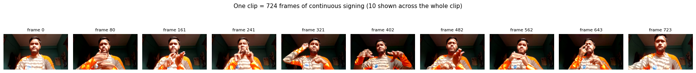
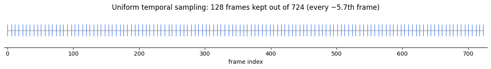
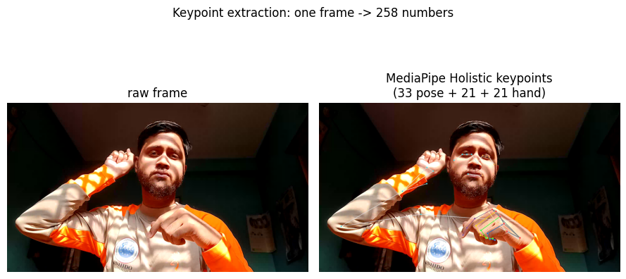
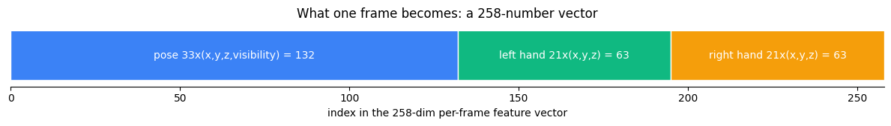
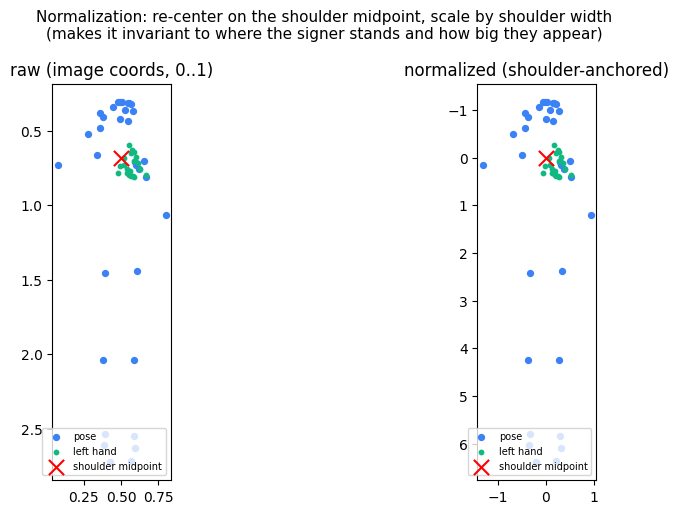
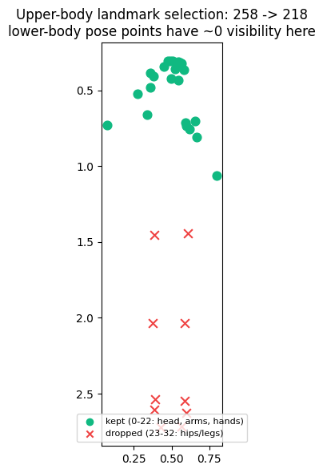

# BdSL → Bangla Text: The Full Pipeline, Explained with Examples

*A visual, end-to-end walkthrough of how a Bangla Sign Language video becomes Bangla
text in this project — every stage shown on one real clip, with figures.*

> **How to read this.** Each stage below is illustrated on a single real clip
> (`f07dbede-…`, a 24.5-second news sentence). Regenerate every figure with
> `python scripts/make_pipeline_figures.py`. Bengali text is shown inline; figure
> labels are kept in English to avoid font issues.

---

## 1. What the dataset contains

**Bornil** is a corpus of **17,988** short videos. Each video is **one signer performing
one Bangla sentence** (front view, indoor, real background). The label is the Bangla
sentence — there is **no word-by-word or sign-by-sign annotation**.

A few real examples (`video_data.csv`):

| Bangla sentence (label) | frames | duration | domain |
|---|---|---|---|
| রাষ্ট্রদূত শাহের ফিলিস্তিনিদের প্রতি সহমর্মিতা প্রকাশ করার জন্য খালেদা জিয়ার কাছে কৃতজ্ঞতা প্রকাশ করেন | 732 | 24.5 s | news / diplomacy |
| এই আমটি একদমই মিষ্টি না | 142 | 9.9 s | everyday speech |
| সংক্ষিপ্ত স্কোর শ্রীলঙ্কা ওভারে থিরিমান্নে দিলশান সাঙ্গাকারা … | 658 | 21.9 s | sports / cricket |

Key facts that shape everything downstream:
- **17,928 of the sentences are unique** — the test set is full of sentences the model
  has never seen. This is **open-vocabulary translation**, not memorization.
- Sentences range from ~4 characters to ~550. Average clip ≈ **500 frames** (~13 s),
  up to ~1,800 frames.
- Per-clip metadata: `view, duration, lighting, camera_distance, is_green_background`.
  (Note: **no signer ID** — we use the 36 `chunk` folders as a session proxy.)

---

## 2. The task — and the language question

We are building **gloss-free Sign Language Translation (SLT)**: **video → Bangla sentence,
directly.**

```
   sign video  ─────────────►  Bangla text
 (keypoints over time)        (subword tokens)
```

**Are we going through English?** **No.** There is **no English anywhere** in this system,
and **no separate "translate to Bengali" step**. The model maps the sign video *straight*
to **Bangla** tokens. English (or ASL/ISL) never enters the pipeline.

**Are we using glosses?** **No.** A "gloss" is a written label for a single sign
(e.g. `AMBASSADOR`). Bornil has none, so we cannot and do not use them. The model learns
the video→sentence mapping directly (this is what "gloss-free" means).

**Three things people often conflate — how they map here:**

| Layer | What it is | In this project |
|---|---|---|
| **BdSL grammar** | how the hands actually sign (its own word order, topic-comment structure, no copula) | the *input* — we learn it implicitly from video |
| **Gloss** | one written word per sign | **not used** (we have no gloss labels) |
| **Bangla text** | the fluent written sentence | the *output* we generate directly |

So the model must bridge two different grammars — BdSL (how it's signed) and written
Bangla (how it's written) — in **one** learned step. That is exactly why this is "translation,"
not just "recognition." (§3.7 shows how we handle Bangla's word structure.)

---

## 3. The preprocessing pipeline

Goal: turn a variable-length video into a fixed, model-friendly numeric array, while a
matching Bangla-text target is tokenized. The guiding principle is **"store raw, transform
at load"** — the expensive MediaPipe pass is done once; cheap transforms happen at training
time so they can change without re-extraction.

### 3.1 Frame sampling — and *is 128 enough?*

A clip has hundreds of frames; a Transformer needs a bounded sequence. We keep at most
**128 frames, spaced uniformly across the whole clip** (not the first 128 — so the entire
sign sequence is covered).





*Example:* the 732-frame clip above → keep every ~5.7th frame → 128 frames.

**Is uniform-sampling-to-128 the standard? What do top papers do?** There is **no single
standard — it depends on the task**, and this is worth being deliberate about:

| Regime | Typical frame handling | Examples |
|---|---|---|
| **Isolated sign** (one sign per clip) | fix a **small** count, commonly **16** (sometimes 32) | ViViT/VideoMAE word-level SLR; 16 frames from the central 48 |
| **Continuous** (a full sentence — **our case**) | keep **full/variable** temporal resolution; downsample **only very long** clips | PHOENIX-2014T CSLR/SLT: "videos > 300 frames downsampled due to memory"; temporal-conv receptive fields ~16 frames |

Our clips are **continuous sentences averaging ~500 frames**. So forcing a fixed **128**
is a **~4–6× downsample** — heavier than what most continuous-SLR/SLT work does (they keep
more, or all, frames and only trim the longest). The risk: fast fingerspelling and
sign-to-sign transitions can fall *between* sampled frames and be lost.

**Recommendation (and an important caveat):**
1. Treat the frame budget as a **first-class hyperparameter** — we already plan a
   `64 / 128 / 256 / full` ablation, and the planned **Mamba/SSM** model exists precisely to
   consume **full-length** sequences cheaply.
2. Prefer **"keep all frames up to a higher cap, downsample only if it exceeds"** over
   *always* forcing 128.
3. **Caveat that matters before the 100% run:** extraction currently **bakes the 128 cap in**
   — MediaPipe only runs on the sampled frames, so the stored `.npy` already has ≤128
   frames. Changing the budget later means **re-running extraction**. So decide the
   extraction cap *before* the full run. Extracting at a higher cap (e.g. 256) costs
   proportionally more time + storage but preserves flexibility for the ablation and for
   video/Mamba models.

*Sources: Sign Language Transformers (Camgöz et al., 2020, arXiv:2003.13830); Temporal Lift
Pooling for CSLR (arXiv:2207.08734); comparative ViViT on word-level SL (PLOS One 2025);
Bangla word-level video transformers (arXiv:2506.04367); Keypoint-based gloss-free SLT
(arXiv:2204.10511).*

### 3.2 Keypoint extraction

For each kept frame we run **MediaPipe Holistic**, which locates body and hand joints. We
keep the coordinates, not the pixels — this makes the model invariant to appearance,
lighting, and background, and keeps it small enough for a single GPU.



Per frame we record **258 numbers**:

| part | landmarks × dims | size |
|---|---|---|
| pose (body) | 33 × (x, y, z, visibility) | 132 |
| left hand | 21 × (x, y, z) | 63 |
| right hand | 21 × (x, y, z) | 63 |



*Example:* the frame above (signer's right hand at the chest) → a length-258 vector like
`[0.51, 0.34, -0.02, 0.99,  … , 0.0, 0.0, 0.0]`. Undetected joints are stored as zeros —
notice the **right hand is not detected** in the scatter in §3.5; that's real, and we track
how often it happens.

### 3.3 Packing

17,988 tiny `.npy` files are slow to read during training. We consolidate them into **one
memory-mapped array** `(N, 128, 258)` plus a `lengths` array holding each clip's true frame
count. Training then does one file-open and pages data on demand.

```
features_packed.npy   shape (17988, 128, 258) float32   ≈ 2.4 GB
lengths.npy           shape (17988,)          int32      (real frame count per clip)
```

### 3.4 Normalization (applied at load time)

The raw coordinates depend on where the signer stands and how large they appear. We
**re-center every frame on the shoulder midpoint and scale by the shoulder width**, applying
the same reference to the body and both hands.



*Example:* the shoulder midpoint (red ✕) moves to the origin `(0, 0)`; a signer on the left
of the frame and one on the right now produce the **same** normalized keypoints. Visibility
values and undetected (zero) joints are left untouched.

### 3.5 Upper-body landmark selection (applied at load time)

In this dataset the lower-body pose joints (hips, knees, ankles — indices 23–32) sit
off-frame with near-zero visibility: they are extrapolated noise. We drop them, going from
**258 → 218** numbers per frame.



*Example:* the red ✗ points (scattered below the body) are the low-visibility leg joints
that get removed; the green points (head, arms, hands) are kept. Result: **`(128, 218)`** —
the actual model input width.

> Because normalization and selection happen **at load time**, we can change them (or run
> ablations like "normalization on/off") **without re-running MediaPipe**.

### 3.6 Target tokenization — and how Bangla word-structure is handled

The output side needs the Bangla sentence as numbers. We use a **SentencePiece BPE**
tokenizer with a **4,000-piece** vocabulary, trained once on all the Bangla labels.

**Why subwords, not whole words?** Because Bangla is morphologically rich and compounding —
exactly the রাষ্ট্রদূত point. Whole-word targets are unlearnable here (25k+ unique words,
most appearing once). Subwords are frequent and reusable. Here is the **real tokenizer
output**:

```
রাষ্ট্রদূত
  pieces : ['▁রাষ্ট্র', 'দূ', 'ত']
  ids    : [2, 892, 3211, 3877, 3]          # 2 = <BOS>, 3 = <EOS>
  decode : রাষ্ট্রদূত

রাষ্ট্রদূত শাহের
  pieces : ['▁রাষ্ট্র', 'দূ', 'ত', '▁শাহ', 'ের']
  ids    : [2, 892, 3211, 3877, 1428, 11, 3]

এই আমটি একদমই মিষ্টি না
  pieces : ['▁এই', '▁আম', 'টি', '▁একদম', 'ই', '▁মিষ্টি', '▁না']
  ids    : [2, 122, 36, 46, 2910, 3895, 2953, 37, 3]
```

Note exactly what you observed: the compound **রাষ্ট্রদূত** is split into the reusable root
**`▁রাষ্ট্র`** ("state") plus **`দূ` + `ত`** — and **আমটি** becomes **আম** ("mango") + **টি**
(a classifier suffix). The `▁` marks a word boundary. This is how we get a **direct
Bangla** target that still generalizes to unseen words: the model composes them from pieces.
Every target is wrapped `[<BOS>] … [<EOS>]` so the decoder knows where to start and stop.

---

## 4. The model — inputs and outputs

The first baseline is **`SignTransformer`**, a standard Transformer encoder–decoder:

```
keypoints (128, 218) ─► Linear(218→256) + positional encoding
                     ─► Transformer ENCODER (4 layers, 8 heads)  ─►  "memory"
                                                                       │ cross-attention
Bangla tokens so far ─► embedding + positions ─► Transformer DECODER ─┘ ─► Linear(→4000)
                                                                          ─► next-token probs
```

**Input → output, concretely:**

```
INPUT   : (128, 218)  — the signer's normalized body+hand landmarks over time
DECODING: <BOS> → "▁রাষ্ট্র" → "দূ" → "ত" → "▁শাহ" → "ের" → … → <EOS>
OUTPUT  : "রাষ্ট্রদূত শাহের ফিলিস্তিনিদের প্রতি সহমর্মিতা প্রকাশ করার জন্য …"
```

At each step the decoder predicts the next subword; SentencePiece stitches the pieces back
into text. (At 1% of the data this output is near-random — 144 training clips can't learn
open-vocabulary translation; that is a data-size floor, not a model bug. The `overfit-tiny`
test proves the model learns correctly when data suffices.)

This is a **deliberately standard baseline**. To make it competitive we add — and tune on
the validation split — LR warmup + decay, label smoothing, and beam search; the *best*
model is then chosen empirically against the full baseline suite (§6), with bootstrap
confidence intervals.

---

## 5. Training & evaluation

- **Loss:** cross-entropy on the shifted target (predict token *t+1* from tokens *≤t*),
  ignoring padding — standard sequence-to-sequence "teacher forcing."
- **Splits:** three official, leakage-checked splits — `random`, `signer-independent`
  (disjoint chunks), and `unseen-sentence` (zero train/test sentence overlap).
- **Metrics (locked, reproducible):** SacreBLEU (BLEU-1..4), **chrF / chrF++**
  (character-level — important for Bangla morphology), ROUGE-L, and BanglaBERT-BERTScore,
  each with **bootstrap confidence intervals**.
- **Decoding for eval:** greedy (baseline) / beam search, then detokenize and score against
  the reference sentence.

Every run writes a row to `docs/logs/EXPERIMENTS.md` (model, split, metrics, config hash,
checkpoint) so every number is reproducible.

---

## 6. Where this is heading (the model suite)

The Transformer is baseline #1. The benchmark will add, on the **same** splits and metrics:

| Family | Models | Input | Status |
|---|---|---|---|
| Keypoint (baselines) | BiLSTM+attn, **Transformer** | 218-d keypoints | Transformer ✅ built |
| Keypoint (stronger) | ST-GCN (graph), Conformer, **Mamba/SSM** (full-length) | keypoints | planned |
| Keypoint (novel) | self-supervised pretraining, keypoint→Bangla-LLM decoder | keypoints | planned |
| **Video** | **ViViT**, VideoMAE-v2 | **RGB frames** | planned — **needs RGB extraction (not done yet)** |

> **ViViT specifically:** it is in the plan (video-model tier) but **not built**, and it
> **cannot run on keypoints** — it needs RGB frames, which our current preprocessing does
> **not** extract. Adding it requires a second extraction pass that stores RGB.

---

## Appendix — reproduce the figures

```bash
python scripts/make_pipeline_figures.py            # writes docs/assets/pipeline/*.png
python scripts/make_pipeline_figures.py --clip chunks/chunk_X/<uuid>.webm   # any clip
```

Figures are generated by running the *actual* preprocessing code
(`bsl_extract`, `bornil.data.transforms`) on the chosen clip — they are not mock-ups.
