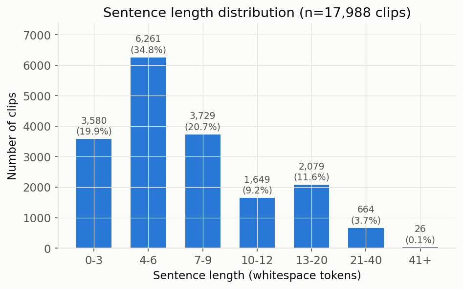
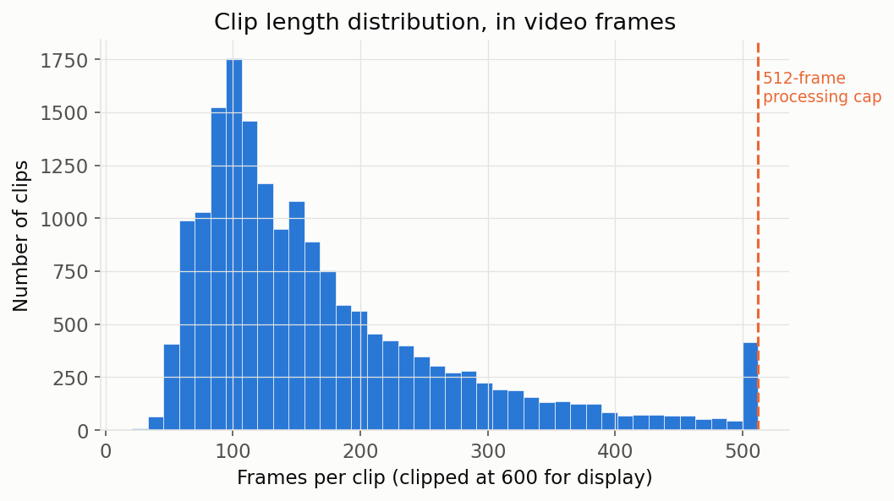
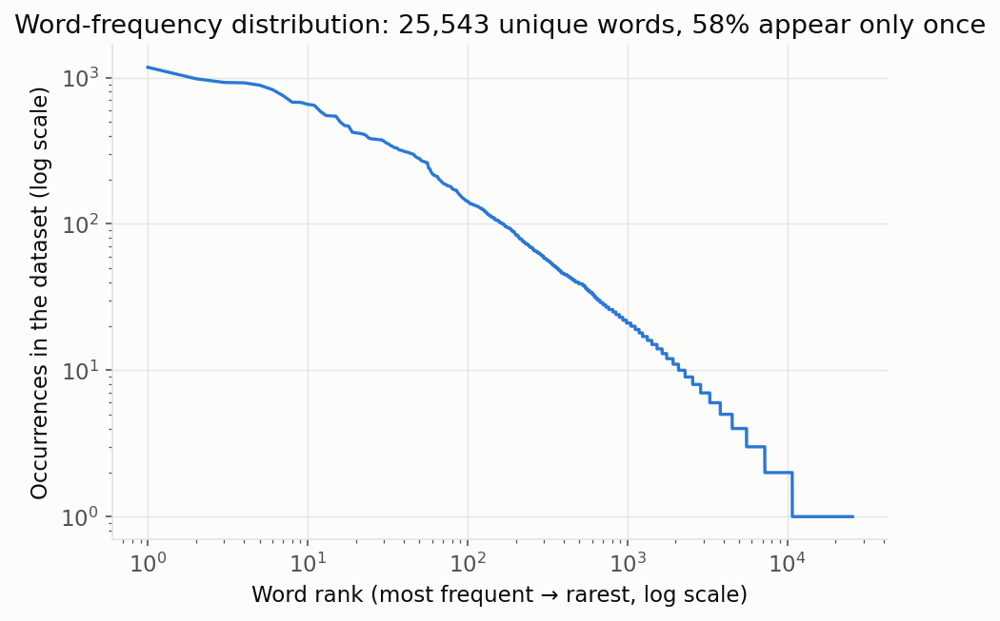
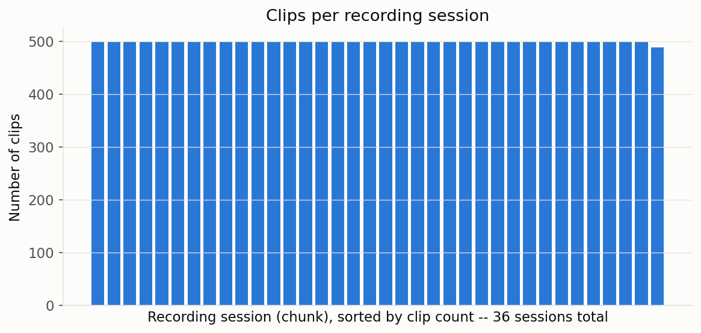
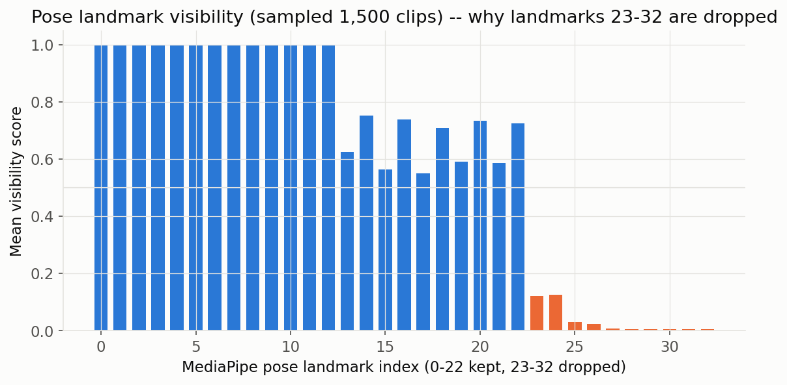

# 1. Introduction

## 1.1 What this project is

Bangla Sign Language (BdSL) is used by a large Deaf community in Bangladesh, but there is no widely available system that automatically converts a video of someone signing into written Bangla text. Every other major written language has mature machine translation; Bangla Sign Language does not. This project — **Bornil** — is building and rigorously benchmarking a system that watches a video of a person signing a Bangla sentence and outputs that sentence in written Bangla, directly, without a human interpreter.

This report is a complete, from-scratch account of the project: the data, the problem it poses, the pipeline that turns raw video into something a model can learn from, every model architecture that has been tried, what worked, what did not, and why, and what remains open. It assumes no prior background in machine learning or sign language research — every technical term is defined in plain language the first time it is used.

## 1.2 Why it matters

Two reasons, both real:

1. **Accessibility.** A working, reliable BdSL-to-text system would let a Deaf signer type a sentence by signing it, or let a hearing person read what a Deaf signer is communicating, without a human interpreter present. This is a genuine, unmet need for Bangladesh's Deaf community.
2. **Research gap.** Sign language translation research is dominated by higher-resource sign languages (American Sign Language, German Sign Language) with existing benchmarks and years of prior work. Bangla Sign Language has comparatively little of this infrastructure. This project builds a large, open, carefully-documented dataset and benchmark specifically for BdSL, intended as a public research contribution (a submission is planned to NeurIPS's Datasets & Benchmarks track — a major AI research venue where new, well-documented datasets and evaluation protocols are peer-reviewed and published the way scientific findings are).

## 1.3 What we are doing, in one paragraph

We collected thousands of short videos, each showing one signer performing one Bangla sentence. From each video we extract the moving positions of the signer's body and hands (not the raw pixels — see §4). We then train machine learning models to read that sequence of body-position numbers and produce the matching Bangla sentence, one piece of a word at a time, the way a human interpreter would after watching the whole sentence being signed. We test many different model designs against each other, using a fixed, fair scoring method, and we keep an honest public record of every experiment — including the ones that did not work.

## 1.4 The data, at a glance

| Fact | Value |
|---|---:|
| Total video clips | 17,988 |
| Distinct sentences | 17,928 (99.6% unique) |
| Total raw video | ~180 GB |
| Recording sessions | 36 |
| Average clip length | ~171 video frames (~5–6 seconds) |
| Average sentence length | 7.7 words |
| Distinct Bangla words in the labels | 25,543 |

The near-total sentence uniqueness is important: this is an **open-vocabulary** task. A system cannot memorize a fixed list of sentence-to-sign mappings; it has to generalize to sentences it has never seen, the way real translation does. The full breakdown of these numbers, with charts, is in §3.

## 1.5 How this report is organized

§2 gives background on sign language translation as a research problem. §3 is a full exploratory data analysis of the dataset with real charts. §4 explains, at a high level and in plain language, how the system works end to end. §5 covers methodology in detail: preprocessing, every model architecture tried, and the training/evaluation protocol. §6 presents results — comparison tables, charts, real example translations, and an honest account of what the numbers do and do not prove. §7 discusses what the results collectively mean. §8 states the project's known limitations plainly. §9 covers reproducibility. §10 concludes and lays out what's next. §11 is a glossary of every technical term used. §12 is an appendix with the complete run ledger and significance tables.

---

# 2. Background & Related Context

## 2.1 Why sign language translation is a hard, distinct problem

Translating a spoken/written language into another spoken/written language is hard enough. Sign language translation is a different kind of hard, for reasons that have nothing to do with the strength of the AI model:

- **There is no written form for most signs.** Spoken Bangla has an alphabet; a BdSL sign does not have a standard written symbol. The only "text" that exists for training is the eventual output sentence — never a transcription of the signing itself.
- **Sign language grammar is not spoken/written language grammar.** BdSL, like most sign languages, has its own word order and grammatical structure (topic-comment ordering, no direct equivalent of some verb forms) that differs from written Bangla sentence structure. A system has to bridge two different grammars in a single learned step, not just "recognize signs and read them out in order."
- **Meaning is carried by more than the hands.** Facial expression, body posture, and the speed/sharpness of a movement all carry grammatical or semantic information in sign languages, not just decoration.

## 2.2 Gloss-based vs. gloss-free approaches

Most existing sign language translation research relies on **glosses** — a hand-written label for each individual sign, similar to writing `AMBASSADOR` under a video frame where that sign occurs. Glosses give a model an intermediate, word-by-word target that is much easier to learn from than jumping straight to a fluent sentence. The catch: producing gloss annotations requires an expert to watch every video and hand-label every sign, which is slow, expensive, and simply does not scale to a large open-vocabulary dataset.

**Bornil has no gloss annotations.** Every clip is labeled only with the final Bangla sentence — nothing about which sign happened when. This project is therefore doing **gloss-free** sign language translation: learning the mapping from raw signing video directly to a fluent sentence, with no intermediate word-by-word supervision. This is harder to train (the model has to discover its own internal notion of "signs" without ever being told what one is), but it is far more scalable — it is the only approach that can realistically produce a large, open dataset like this one.

## 2.3 Why Bangla specifically

Bangla is spoken by over 230 million people, and Bangladesh's Deaf community is correspondingly large — but Bangla Sign Language has very little of the NLP/AI research infrastructure that exists for higher-resource sign languages. There is no standard, public, benchmark-quality BdSL dataset with a locked evaluation protocol prior to this project. That gap is what this project is built to close.

## 2.4 This project's specific contributions

1. **An open dataset**: 17,988 labeled BdSL video clips, open-vocabulary, real-world recording conditions.
2. **A frozen, leakage-checked benchmark**: three official train/test splits, each testing a different kind of generalization (§5.3), released as versioned split files so results are reproducible.
3. **A locked metric protocol**: the same scoring method, computed the same way, for every model tried, with statistical significance testing rather than raw-number bragging.
4. **A baseline model suite**: several standard and non-standard architectures trained and compared under identical conditions.
5. **A novel-method comparison**: three more experimental approaches, evaluated head-to-head against the baseline suite for a project "flagship" method (§5.2, §6).
6. **An alignment/interpretability study**: an attempt to recover, after the fact, which part of a video corresponds to which word — without ever having been given that information during training.
7. **A public, honest negative-results record**: every dead end is logged with what was expected, what happened, and the best-guess reason why, rather than only reporting what worked.

---

# 3. The Dataset & Exploratory Data Analysis

This section presents the dataset on its own terms, with real charts computed directly from the project's data files (not estimates), before any modeling discussion.

## 3.1 Overview

Bornil consists of 17,988 short `.webm` video clips. Each clip shows one signer, front-facing, mostly indoors, performing one complete Bangla sentence. There is no frame-by-frame or sign-by-sign annotation — only the final sentence label. Some real examples, drawn directly from the dataset:

| Bangla sentence (label) | Domain |
|---|---|
| রাষ্ট্রদূত শাহের ফিলিস্তিনিদের প্রতি সহমর্মিতা প্রকাশ করার জন্য খালেদা জিয়ার কাছে কৃতজ্ঞতা প্রকাশ করেন | news / diplomacy |
| এই আমটি একদমই মিষ্টি না | everyday speech |
| সংক্ষিপ্ত স্কোর শ্রীলঙ্কা ওভারে থিরিমান্নে দিলশান সাঙ্গাকারা … | sports / cricket |

The clip-to-label relationship is **clip-level, not frame-level**: one video clip maps to one sentence, with no marking of which moment in the video corresponds to which word. This is the direct consequence of the gloss-free design decision in §2.2, and it is why the alignment study in §6.6 exists — someone eventually has to ask "can we recover that alignment after the fact, even though we never had it during training?"

## 3.2 Sentence length distribution



Most sentences are short to medium length: the average sentence is 7.7 whitespace-separated words long (median 6), with 90% of sentences at 15 words or fewer. A real minority of long, complex sentences exists — up to 77 words for the single longest label in the dataset. This distribution matters later: a separate diagnostic experiment (the "LTE12" diagnostic track, §8) specifically tested model behavior on the shorter/medium majority of the data versus the long tail, because early diagnostics showed the model struggled disproportionately on the longest, most complex sentences.

## 3.3 Clip duration / video length distribution



Clips range from a couple of seconds to about half a minute of continuous signing. The average clip is about 171 video frames long (roughly 5–6 seconds at typical recording frame rates), with a median of 139 frames. The system processes up to 512 video frames per clip; the chart shows this comfortably covers the large majority of the dataset — only about 2.1% of clips are long enough to be cut off at that limit. This is a deliberately generous cap: an earlier, smaller-scale version of this pipeline capped clips at 128 frames (a 4–6× downsampling of a ~500-frame average clip, and a real risk of losing fast hand transitions between signs); the current, full-scale pipeline was extended to 512 frames specifically to avoid that loss for all but the longest tail of clips.

## 3.4 Vocabulary analysis



The dataset's 17,988 sentence labels contain 25,543 distinct Bangla words, and **58% of those words appear only once** in the entire dataset. The chart above shows this as a classic "Zipf" pattern (a small number of very common words, and a very long tail of rare ones) — on a log-log plot, this shows up as a nearly straight declining line, exactly what's visible above.

This single fact drives an important design decision explained in §5.1.5: a model cannot realistically learn to predict whole words directly, because most words are seen only once or a handful of times during training — there simply isn't enough repetition to learn them as atomic units. This is why the target text is broken into reusable **subword pieces** instead (explained with a real worked example in §5.1.5).

## 3.5 Recording-session (signer) diversity



The dataset does not include an explicit "signer ID," but clips are grouped into 36 recording sessions (folders), which serve as the practical stand-in for "who was signing and under what conditions." The chart shows these sessions are strikingly uniform in size — nearly every session contains exactly 500 clips (one has 488) — meaning no single session dominates the dataset. This matters directly for the benchmark design in §5.3: one of the three official evaluation splits specifically holds out *entire* recording sessions from training, to test whether a model generalizes to signing style/conditions it has never encountered, rather than just memorizing details of the sessions it trained on.

## 3.6 Data quality: why some body points are dropped



Every video frame is processed by a computer-vision tool (MediaPipe, explained fully in §4 and §5.1.1) that tries to locate 33 body points, 21 left-hand points, and 21 right-hand points. Each detected body point comes with a *visibility score* — essentially, how confident the tool is that it actually found that point, versus guessing. The chart above shows, for each of the 33 body points, its average visibility across a large sample of real clips. There is a sharp drop-off exactly at the boundary between the upper-body points (head, shoulders, arms — consistently ~0.85–1.0 visibility) and the lower-body points (hips, knees, ankles, feet — averaging just 0.03 visibility). That drop-off is not surprising once you know why: these videos are recorded front-facing and mostly framed from roughly the waist up, so the lower body is usually out of frame or barely visible, and the "positions" MediaPipe reports for those points are mostly extrapolated noise, not real detections.

Because of this, the lower-body points are dropped entirely before the data reaches any model, taking the per-frame feature count from 258 down to 218 numbers (the full breakdown is in §5.1.4). This is a concrete example of a preprocessing decision made from evidence, not assumption.

## 3.7 Split composition — the three official benchmarks

Every result in this report is measured against one of three official, frozen (fixed once and never changed afterward, so results stay comparable over time) train/test splits. Each answers a different question about generalization:

| Split | Train clips | Val clips | Test clips | What it tests |
|---|---:|---:|---:|---|
| `random-v1` | 14,390 | 1,799 | 1,799 | The easiest, most standard setting — clips assigned to train/test at random |
| `signerindep-v1` | 14,500 | 1,988 | 1,500 | Whether the model generalizes to an entirely unseen *recording session* (signing style/conditions never seen in training) |
| `unseen-sentence-v1` | 14,390 | 1,799 | 1,799 | Whether the model generalizes to a *sentence it has never seen*, in any form, during training |

All three splits are **leakage-checked** — verified, in code, that no clip and (for the harder two splits) no recording session or sentence appears on both sides of the train/test boundary. This is what makes "the model scored X" a meaningful, trustworthy claim rather than an accidental open-book exam.

## 3.8 What the EDA drove

Every finding in this section fed a real downstream decision, not just background color: the frame-length distribution justified the 512-frame processing cap (§3.3); the vocabulary distribution justified subword tokenization over whole-word prediction (§3.4, §5.1.5); the landmark-visibility numbers justified dropping the lower-body points (§3.6); and the session-diversity and split-composition numbers directly define the three-way generalization test that every model in this report is scored against (§3.7, §5.3).

---

# 4. System Architecture — How It Works

At the highest level, the system is a pipeline with four stages:

```
  Video of someone signing
          |
          v
  "Skeleton tracking" -- locate the hands/body in every frame
          |
          v
  A numeric pattern the computer can read (not pixels -- positions over time)
          |
          v
  An AI model reads the pattern and understands it
          |
          v
  A Bangla sentence, written out
```

**Stage 1 — the video.** A short clip of a person signing a sentence in front of a camera. Nothing is done to this beyond what any video player would do.

**Stage 2 — "skeleton tracking."** A widely-used computer-vision tool (MediaPipe, made by Google) processes the video frame by frame and marks the exact position of the signer's hands, fingers, arms, shoulders, and head. This is conceptually the same idea as the motion-capture dots used in movies and video games to record an actor's movement — except no special suit, markers, or equipment is needed; it works directly on a normal video recording.

**Stage 3 — the pattern.** Those tracked positions, frame after frame, become a long sequence of numbers describing exactly how the signer's body and hands moved over time. This — not the video pixels themselves — is what the AI model actually reads. Working with positions instead of raw video pixels makes the system smaller, faster to train, and insensitive to things that shouldn't matter (lighting, background, clothing color, exactly where in the frame the signer is standing).

**Stage 4 — the AI model.** The model has two connected halves, commonly called an **encoder** and a **decoder**:
- The **encoder** reads the entire movement sequence for a clip and builds an internal understanding of it — a compressed numeric summary of "what happened in this video."
- The **decoder** then writes out the Bangla sentence, one small piece of a word at a time, using that summary to guide each choice, and using what it has written so far to decide what to write next.

A useful analogy: this is like a human interpreter who watches an *entire* sentence being signed before starting to speak, rather than guessing word by word while it's still happening. The encoder is the "watching and understanding" half; the decoder is the "now saying it" half.

**No English, and no fixed sign dictionary, anywhere in this system.** The model maps the video straight to Bangla. There is no intermediate translation through English or any other language, and — as explained in §2.2 — there is no fixed lookup table of "this sign means this word." The mapping from movement to sentence is learned entirely from examples.

The next section (§5) explains exactly how each stage is built, what changed as the project evolved, and every specific model design that was tried for stage 4.

---

# 5. Methodology

## 5.1 Data preprocessing — what, why, with real examples

The guiding principle behind preprocessing is **"store raw, transform at load."** The expensive computer-vision step (running MediaPipe over every frame of every clip) happens once, up front, and its raw output is saved. Everything downstream of that — normalization, which body points to keep, how the text is tokenized — happens at training/loading time, cheaply, so those choices can be changed or experimented with without ever re-running the expensive extraction step.

### 5.1.1 Keypoint extraction


For every kept frame, MediaPipe Holistic locates body and hand joints and reports their position as numbers rather than pixels. This is the "skeleton tracking" step from §4. Per frame, 258 numbers are recorded:

| Part | Landmarks × dimensions | Count |
|---|---|---:|
| Pose (body) | 33 × (x, y, z, visibility) | 132 |
| Left hand | 21 × (x, y, z) | 63 |
| Right hand | 21 × (x, y, z) | 63 |

A joint MediaPipe cannot detect in a given frame (e.g. a hand briefly out of camera view) is recorded as zeros — this happens in real recordings, and the pipeline tracks how often.

### 5.1.2 Packing

Reading 17,988 tiny individual files during training would be slow. All clips' raw features are consolidated into one large array (17,988 × 512 × 258 numbers, about 8.9 GB) plus a small companion array recording each clip's true frame count (since not every clip uses the full 512-frame budget). Training then reads from this one file efficiently instead of opening thousands of small ones.

### 5.1.3 Normalization (applied at load time, not baked into the stored file)


Raw joint positions depend on where a signer happens to stand in the frame and how close they are to the camera — two things that should not change what the model thinks a sign means. Every frame is re-centered on the midpoint between the shoulders and rescaled by shoulder width. The analogy: it's like scaling a photo so a person's apparent height doesn't depend on how far away the camera was — after this step, a signer standing on the left of frame and one standing on the right (or one closer to the camera and one farther) produce the *same* normalized numbers for the same physical movement.

### 5.1.4 Upper-body landmark selection


As established with real numbers in §3.6, the lower-body pose points (hips, knees, ankles — indices 23–32) are dropped because they carry almost no real signal in this front-facing, upper-body-framed dataset. This takes the per-frame feature count from 258 down to **218** — the actual width of the model's input.

### 5.1.5 Target tokenization — turning Bangla sentences into learnable pieces

As shown in §3.4, most individual Bangla words in this dataset are too rare to learn as whole units — 58% appear only once. The solution is a **SentencePiece BPE tokenizer** (Byte-Pair Encoding — a standard, widely-used method): instead of one unit per whole word, the vocabulary consists of 4,000 frequently-reused *sub-word pieces*, and any word — even one the tokenizer has never seen as a whole — can be built by combining pieces it has seen before. A real worked example, using the actual trained tokenizer:

> **রাষ্ট্রদূত** ("ambassador") splits into pieces: **রাষ্ট্র** + **দূ** + **ত** — the first piece is a reusable root meaning roughly "state," the other two are suffix pieces.
>
> **আমটি** ("the mango") splits into pieces: **আম** ("mango") + **টি** (a grammatical classifier suffix).

The compound word রাষ্ট্রদূত is split into a reusable root piece meaning roughly "state," plus two short suffix pieces — none of which need to have been seen attached to this exact word before. This is what lets the model handle Bangla's rich word-formation (compounding, suffixes) and still generalize to sentences and words it never saw during training, which is essential given the open-vocabulary nature of this dataset (§1.4).

## 5.2 Building the model(s) — an overview

This project did not build one model — it ran a structured comparison of several different designs, evaluated under identical, fair conditions. The table below is the map; each row gets its own detailed subsection.

| # | Approach (plain description) | Outcome |
|---|---|---|
| 1 | Baseline: read the movement, write the sentence | Working baseline |
| 2 | + a component for noticing short bursts of motion (temporal convolution) | No statistically supported improvement |
| 3 | + a second training signal that helps line up video and sentence while learning (CTC) | **Best-performing version — current flagship baseline** |
| 4 | Alternative "reading" design based on skeleton/graph structure | Negative result |
| 5 | Alternative "reading" design based on a newer, more efficient sequence-modeling idea | Blocked by a hardware/speed limit before completion |
| 6 | Pre-training the model on videos alone before the real training | Negative result |
| 7 | Giving the "writing" half a head start from an AI that already knows fluent Bangla | Design complete, implementation in progress |

### 5.2.1 The baseline model

The first model built (internally: `SignTransformer`) is a standard encoder-decoder Transformer — the same general family of architecture behind most modern machine translation systems, applied here to a sequence of body-position numbers instead of a sequence of words. Concretely: the 218 numbers per frame are projected into a 256-number internal representation, a 4-layer Transformer encoder reads the whole movement sequence, and a 4-layer Transformer decoder generates the Bangla sub-word sequence one piece at a time, attending back to the encoder's understanding of the video at every step.

This is a deliberately standard, unglamorous baseline — the point of building it first is to have an honest, unremarkable floor that every subsequent idea has to actually beat, with statistical proof, not just a bigger raw number.

### 5.2.2 Adding a short-range motion component (TConv)

The next idea tested was adding a small "temporal convolution" component in front of the encoder — a component whose whole job is to look at a short local window of nearby frames (a handful of frames before and after each point in time) and pick up on short bursts of motion before the main model sees the sequence. This is a common, cheap addition in sequence models.

**Result:** it looked promising on raw numbers (the accuracy score went up), but formal statistical significance testing showed the improvement was **not statistically significant** — it could plausibly have been due to chance rather than a real effect (a paired-bootstrap significance test, explained in §5.3, gave p = 0.486, far above the standard 0.05 threshold for calling a result real). This is an important, disciplined finding in its own right: a number going up is not the same as a real improvement, and this project does not claim a win without the statistics to back it.

### 5.2.3 Adding a second training signal for alignment (CTC) — the best-performing model

The idea that ended up mattering most: training the model with a **second, additional training signal** alongside the main one. This second signal (called CTC — Connectionist Temporal Classification) forces the model's video-reading half to also predict, frame by frame, which sub-word piece is happening at that moment — even though the model was never told this during data collection (recall: there is no frame-by-frame annotation in this dataset). This acts as a kind of self-supervised training scaffold that helps the model's video-understanding half stay well-organized and closely tied to the actual visual content, not just to whatever the decoder finds convenient to output.

**Result:** this became the best-performing model in the entire project (full numbers in §6.1). It significantly beat both the plain baseline and the temporal-convolution-only variant on the project's primary metric, generalized to all three official splits (not just the easiest one), and — as an additional, valuable side effect — this same trained model is what made the alignment study in §6.6 possible at all, since its frame-by-frame predictions are exactly what that later analysis needed to probe.

### 5.2.4 Alternative reading design: skeleton/graph-structured encoder

The keypoints extracted in §5.1.1 aren't just a flat list of numbers — they have real spatial structure (a wrist connects to a hand, which connects to fingers; a shoulder connects to an elbow, which connects to a wrist). One alternative model design (an ST-GCN, "spatio-temporal graph convolutional network") explicitly builds this joint-to-joint connectivity into the model itself, treating each frame as a small graph and learning how signal propagates across that graph over time — a design specifically intended to model *motion* well.

**Result:** a clear negative result. This model scored significantly *below* both the plain baseline and the CTC model on the project's primary metric, and it took roughly 57 times longer to train (about 43 hours vs. 45 minutes) for a worse outcome. The most likely explanation, discussed fully in §6.5 and §7, is that this dataset's exploitable signal turns out to be dominated by static body/hand *pose*, not *motion* — so an architecture whose whole advantage is modeling motion has comparatively little to win on here. This is exactly the kind of result this project logs and reports plainly rather than hiding (see §7 for how this negative result connects to several others).

### 5.2.5 Alternative reading design: a newer, more efficient sequence model (Mamba/SSM)

A third alternative design was based on a newer family of sequence models (state-space models, sometimes called "Mamba" after the architecture that popularized them), which process a sequence more efficiently than a standard Transformer for very long inputs. The official, pre-built version of this architecture could not be installed and run on the project's own hardware (its core component requires specialized compiler tooling not available in this environment), so a from-scratch re-implementation using only standard, portable tools was built instead.

**Result:** blocked by a real hardware/speed limit, discovered *before* any wasted large-scale run — a required timing check (built specifically to catch exactly this kind of problem before committing days of compute to it) found that this re-implementation would need well over 60 hours to complete a single full training run, dramatically slower even than the already-slow graph-based model in §5.2.4. No comparison was ever run; this is a "we could not test this here" result, not a "we tested it and it lost" result. It remains open for revisiting with either a faster re-implementation or different hardware.

### 5.2.6 Pre-training on video alone before the real training

A fifth idea: give the model a "head start" by first having it practice purely on the videos themselves — with no sentence labels at all — before the real, labeled training begins. Concretely, the model is repeatedly shown a video with random chunks of it hidden, and asked to reconstruct the hidden parts from what's visible around them (a well-established self-supervised technique). The hope: this teaches the model something generally useful about how bodies move and how signs are structured, which the real, labeled training could then build on — particularly valuable if labeled data is scarce.

**Result:** a clear negative result, tested two different ways. First, giving the model this head start did not produce a statistically significant improvement on the hardest official split. Second — and this was the more informative test — the idea specifically predicts it should help *most* when there is *less* labeled data to work with (since the head start should matter more when there's less real training data to compensate). This was tested directly by re-running the comparison at 10%, 25%, 50%, and 100% of the normal amount of labeled training data. The pre-trained version was **worse than training from scratch at every single one of those four points**, not better — the opposite of the prediction. Both findings are logged and discussed in §6.5 and §7.

### 5.2.7 In progress: a pretrained Bangla-language decoder

The current, not-yet-complete experiment: instead of the decoder (the "writing" half of the model, §4) learning Bangla from scratch using only this project's ~14,000 training sentences, start from an existing AI system that has already been trained on a very large amount of general Bangla text and therefore already "knows" how to write fluent, grammatical Bangla — then teach *that* system to read the sign-language movement patterns from §5.1, adapting it efficiently (using a lightweight training technique called LoRA that updates only a small fraction of the pretrained system's internal parameters, leaving most of its existing Bangla knowledge untouched).

This design is fully specified and its implementation is underway; results are not yet available at the time of this report. It carries a specific, named risk worth stating plainly now: a decoder that already "knows" fluent Bangla could learn to produce fluent-*sounding* sentences without actually paying close attention to the video — i.e., score well on a fluency-sensitive metric while secretly ignoring the input. The evaluation plan for this experiment includes a mandatory check reusing this project's existing grounding test (§6.4) specifically to catch that failure mode before any accuracy number is trusted on its own.

## 5.3 Training & evaluation protocol

**Splits.** As established in §3.7, every result is measured on one of three frozen, leakage-checked splits, each testing a different generalization question (random assignment / unseen recording session / unseen sentence).

**Training.** "Training" means: repeatedly showing the model labeled examples (a video's movement pattern paired with its correct Bangla sentence), letting it make a prediction, measuring how wrong that prediction was, and nudging its internal parameters slightly to make it less wrong next time — repeated many thousands of times over the training set. A portion of the data (the validation split) is checked periodically during training but never used to directly adjust the model, so progress can be tracked honestly; the test split is touched only once, at the very end, to produce the final reported number.

**Significance testing.** A raw number being higher does not by itself prove one model is genuinely better than another — it could be luck (which exact examples happened to be easy or hard). This project uses **paired bootstrap significance testing**: the test set is resampled with replacement thousands of times, and a score difference is only reported as "real" if it holds up consistently across that resampling (a standard statistical practice, reported as a p-value — a value below 0.05 is the conventional threshold for "this is very unlikely to be pure chance"). Every comparison in §6 that claims one model beats another has passed this check; the ones that didn't pass are reported as not statistically supported, not silently dropped.

**Compute.** Training ran on a single consumer GPU (an NVIDIA RTX 3070). Training times varied enormously by architecture — from about 45 minutes for the best-performing model, to nearly 43 hours for the graph-based alternative in §5.2.4, to a projected 60+ hours (and therefore never actually run to completion) for the re-implemented Mamba/SSM design in §5.2.5.

---

# 6. Results

## 6.1 How the scoring works, before any numbers

The primary metric used throughout this report is **chrF++**, a score from 0 to 100 that measures how much of the correct sentence's spelling shows up in the model's answer, checked character by character (not just whole-word matches) — a standard, widely-used metric for morphologically rich languages like Bangla, where a single word can take many different suffixed forms. BLEU-4 (the classic machine-translation metric, also 0–100, based on whole-word overlap) and ROUGE-L are also reported for completeness, but **chrF++ is the metric this project relies on for real conclusions** — on this dataset, BLEU-4 sits so close to zero for every model tested that it cannot reliably distinguish a good model from a bad one (this is explained further, with the actual numbers, in §6.3).

## 6.2 Headline comparison

The following table shows every major model tried on the `random-v1` split (the standard, easiest-generalization setting), all measured identically, all with significance tests against the plain baseline:

| Model | chrF++ | BLEU-4 | ROUGE-L | Verdict |
|---|---:|---:|---:|---|
| Plain baseline (§5.2.1) | 9.65 | 0.52 | 0.055 | Reference point |
| + motion component (§5.2.2) | 9.48 | 0.66 | 0.054 | Not statistically supported |
| **+ CTC alignment signal (§5.2.3) — best model** | **10.91** | 0.68 | 0.067 | **Significantly better than baseline (p<0.001)** |
| Skeleton/graph-based design (§5.2.4) | 8.27 | 0.36 | 0.040 | Significantly worse than baseline (p<0.001) |
| Mamba/SSM design (§5.2.5) | — | — | — | Never completed — compute-blocked |

The best model — the baseline plus the CTC alignment signal — significantly beats the plain baseline and generalizes to the two harder official splits as well: chrF++ rises from 8.38 to 10.36 on the unseen-recording-session split, and from 9.19 to 10.94 on the unseen-sentence split (both improvements statistically significant, p<0.001).

## 6.3 Why beating a naive baseline is a meaningful bar (and why it's a lower bar than it looks)

A model that has learned nothing real about sign language can still score deceptively well on a metric like chrF++, simply because Bangla sentences share a lot of common characters and short words. To make sure "beating a naive comparison point" is a meaningful claim, this project checked the best model against several trivial, non-learning comparison points on the same test data:

| Comparison point | chrF++ | What it represents |
|---|---:|---|
| Best real model (control input) | 10.91 | The model as actually trained and run |
| Nearest-neighbor retrieval (no learning at all — just copy the closest-matching training example) | 9.20 | The strongest "cheat" that requires no real understanding |
| Feeding the trained model pure random noise instead of a real video | 9.08 | The approximate floor of the metric itself |

The retrieval "cheat" and the pure-noise floor score almost identically (9.20 vs. 9.08) — meaning beating the retrieval floor by a small margin, on its own, is a weaker claim than it first appears, since a system with literally no visual information scores nearly the same. This is why the more important test is the one in §6.4, which changes exactly one thing (whether the video and the sentence actually match) rather than comparing against a different kind of system entirely.

## 6.4 Does the model actually use the video? (the grounding test)

To answer this directly, the trained best model was re-run on the test set with the video-to-sentence pairing deliberately scrambled — each reference sentence was paired with a *different* clip's real movement data, so the overall statistics of the input (how much motion, how long the clip, etc.) stayed exactly the same, and only the actual video-to-sentence correspondence was broken.

| Condition | chrF++ | BLEU-4 | Reads as |
|---|---:|---:|---|
| Real, correctly-paired video and sentence | 10.91 | 0.68 | Model as trained |
| Frame order scrambled within each clip | 10.04 | 0.07 | Motion destroyed, pose kept |
| Video-sentence pairing scrambled | **6.20** | 0.05 | Grounding removed |
| Model fed pure random noise | 9.08 | 0.04 | No visual information at all |

Scrambling the video-sentence pairing costs a large, statistically significant −4.71 chrF++ (from 10.91 down to 6.20) and cuts BLEU-4 to roughly a fourteenth of its original value. **This is strong, direct evidence that the model is genuinely using the video** — its output depends on which specific video it is shown, not just on general knowledge of what Bangla sentences tend to look like.

## 6.5 An honest limitation: the grounding is mostly static pose, not motion

The same test also revealed something more specific and less flattering: scrambling the *order* of frames within a clip — destroying all motion information while leaving the distribution of body poses in the clip completely intact — cost only a small, though still statistically significant, −0.88 chrF++ (92% of the score is retained), while it removed 89% of the BLEU-4 score. In plain terms: **the model currently reads body poses far more than it reads movement.** Word choice/ordering (which BLEU-4 is sensitive to) does depend on real motion information to some degree, but the character-level overlap captured by chrF++ mostly does not.

This single finding retroactively explains two other results in this report: it is consistent with the skeleton/graph-based model (§5.2.4, whose entire design advantage is modeling motion) underperforming on a benchmark where motion turns out not to be the dominant signal, and it is the leading hypothesis for why the frame-level alignment study below could not find what it was looking for.

## 6.6 The alignment study: trying to find which video moment matches which word

A separate line of investigation asked: since the best model's internal predictions are (thanks to the CTC training signal in §5.2.3) already tied to specific moments in the video, can those internal predictions be used to recover, after the fact, a frame-by-frame alignment between the video and the sentence — even though the model was never given that alignment during training?

The recovered alignment was checked against an independent signal that has nothing to do with the model itself: moments where the signer's hands visibly slow down or pause, which is a reasonable, model-independent guess at where one sign ends and the next begins.

**Result:** across all three official splits, the model's internal alignment did **not** land on those motion-pause moments any more often than a randomized chance baseline. This is reported as an open limitation, not a contradiction of §6.4's grounding finding — the same analysis confirmed the model's internal signal is real and responsive to the video (it changes substantially when frames are scrambled), just sparse and not landing where this particular independent check expected it to. The leading explanation is that a "sub-word piece" (the unit the model actually predicts) and a "sign" (a single meaningful hand movement) are not the same size or granularity, so comparing them frame-for-frame may be asking the wrong question. This remains open for future work at the level of whole signs rather than sub-word pieces.

## 6.7 Real example translations

Genuine (reference, model output) pairs from this project's evaluation runs, spanning an exact match, a typical/partial result, and a clear failure mode:

**Exact match** (`random-v1` test set):
> Reference: একটা অদ্ভুত সুন্দর জগত আছে ফুটবলের।
> Model output: একটা অদ্ভুত সুন্দর জগত আছে ফুটবলের। *(identical — a perfect score)*

**Typical / partial result** (`random-v1` test set, near the middle of the score distribution):
> Reference: কতবার নিজের খাবার ওদের দিয়ে দিয়েছেন।
> Model output: কাজের জন্য ছেলে শিশুকে পথ খুঁজেছে।
>
> The model produces a fluent, grammatically well-formed Bangla sentence, but not the correct one — a realistic picture of "typical" behavior on a hard, open-vocabulary task, not a cherry-picked best or worst case.

**Failure mode: repeated-token runaway** (`signerindep-v1` test set):
> Reference: নদীর পাড় সাদা কাশফুলে ভরে যায়।
> Model output: কাক কা কা কা কা কা কা কা কা কা কা কা কা কা কা কা কা কা কা কা কা কা কা কা কা কা কা কা কা কা কা কা কা কা কা কা কা কা কা …
>
> Here the decoder gets stuck repeating a single short piece over and over instead of stopping. This is a known decoding pathology (distinct from the model's ability to understand video); the project tested a "repetition guard" that can clip these runaways during generation without changing the official reported numbers.

## 6.8 Output diversity — ruling out a lazy explanation

A tempting alternative explanation for the best model's chrF++ improvement (§6.2) would be that it simply learned to produce a small number of generic, "safe" sentences that happen to overlap well with many different references, rather than genuinely translating each clip individually. This was checked directly: on `random-v1`, the plain baseline produces a unique sentence for 89.8% of its 1,799 test outputs, while the best (CTC) model produces a unique sentence for **98.8%** of them, and does so while also closing most of a systematic under-generation problem the plain baseline had (the baseline's average output length undershoots the true average reference length; the CTC model's output length nearly matches it). The improvement in §6.2 is not coming from producing shorter, blander, more generic answers.

One model, the graph-based design in §5.2.4, does show a real diversity/decoding pathology: 11.3% of its outputs are the kind of repeated-token runaway shown in §6.7 — a distinct problem from, and additional evidence against, that particular design.

---

# 7. Discussion

Read together, the results in §6 tell one coherent story rather than a list of disconnected findings. The best model is genuinely grounded in the video (§6.4) — it is not simply generating plausible-sounding Bangla from habit — but what it is grounded in is overwhelmingly the *static pose* the signer is holding, not the *motion* of getting there (§6.5). That single finding retroactively explains two other results that would otherwise look unrelated: a model built specifically to exploit motion structure (§5.2.4) underperforms, because the benchmark's exploitable signal isn't dominated by motion in the first place; and an attempt to align the model's internal predictions to motion pauses (§6.6) comes back at chance, for the same underlying reason.

The self-supervised pre-training attempt (§5.2.6) is a different kind of negative result — not obviously connected to the pose-vs-motion story, and its own data-efficiency test (the four-point curve showing pretraining hurt at every labeled-data amount, not just on average) argues against the simplest explanation ("it just needed more labeled data to pay off"). It's logged as an open, unresolved negative result rather than force-fit into the motion narrative above.

The compute-blocked Mamba/SSM attempt (§5.2.5) is the one item on this list that isn't a finding about the model at all — it's a finding about what could be tested on the available hardware in the time available, and it remains genuinely open rather than resolved either way.

Taken together: this project has one clearly, statistically supported model-side win (the CTC alignment signal, §5.2.3), one honestly-characterized and specific technical limitation (static-pose-dominant grounding, §6.5), and three logged negative results that each rule something out rather than leaving it ambiguous. That is a normal, healthy shape for a real research process, and it is being reported that way rather than smoothed over.

---

# 8. Limitations

Stated plainly, as a single reference list:

1. **Static-pose-dominant grounding (§6.5).** The current best model reads body/hand pose far more than movement. Closing this gap is the most important open technical direction for this project.
2. **Signer/session diversity.** The dataset spans 36 recording sessions (§3.5); the signer-independent split shows a real, though partially closed, generalization gap relative to the random split, meaning performance on entirely new signing styles/conditions remains harder than on styles seen during training.
3. **Long-sentence performance.** The sentence-length distribution (§3.2) has a real long tail; earlier diagnostics found the model performs worse on the longest, most complex sentences than on the short-to-medium majority, motivating (but not fully resolving) a separate filtered diagnostic track.
4. **Compute constraints.** At least one promising architectural direction (§5.2.5) could not be evaluated at all on the hardware available to this project within a practical time budget.
5. **Benchmark-level limits.** This is, at present, a single dataset covering one sign language; BLEU-4 (§6.1) is not a reliable discriminating metric on this benchmark and should not be used alone for future model comparisons on this data.
6. **Frame-level alignment remains unresolved (§6.6).** This project cannot currently say, with any confidence above chance, which part of a video corresponds to which word — an open problem for any future work that needs that information (e.g. a sign-generation or avatar system running this in reverse).

---

# 9. Reproducibility

Everything needed to reproduce any specific result in this report is version-controlled: the exact configuration file for every model run, the frozen split files defining train/test membership for all three official splits, the trained subword tokenizer, and the complete code for preprocessing, every model architecture, training, and evaluation. Every run referenced in this report has a corresponding entry in the project's run ledger recording its exact configuration, training time, and test-set metrics, so any number in this report can be traced back to precisely the run that produced it.

The raw video (~180 GB) and the large intermediate/output files (the packed keypoint dataset and every model's saved checkpoint, together roughly 15 GB) are not distributed alongside the code — they are regenerable from the raw video via the documented pipeline, and are kept separately for practical size reasons, not availability reasons. Given the same raw video and the same versioned configuration file, any result in this report is exactly reproducible.

---

# 10. Conclusion & Future Work

This project set out to build and rigorously benchmark a gloss-free Bangla Sign Language to text system, on a large, genuinely open-vocabulary dataset, with no prior standard benchmark to build on. It has done so: a frozen three-way benchmark, a locked and statistically-disciplined evaluation protocol, a working best model that is demonstrably grounded in the actual video content, and an honest, complete record of both the wins and the dead ends encountered along the way.

**What's immediately next:**
- Finishing the in-progress pretrained-Bangla-decoder experiment (§5.2.7) and running its mandatory grounding check before trusting any accuracy number from it.
- Using that result to make a final, evidence-based decision on which of the project's experimental directions becomes its flagship method for publication.
- Continuing to work on the project's most important named limitation — closing the gap between "reads static pose well" and "reads motion well" (§6.5, §8).

**Longer-horizon direction:** publishing the dataset, the frozen benchmark, and this project's full experimental record as a public research contribution, so other researchers working on under-resourced sign languages have a real, documented starting point rather than none.

---

# 11. Glossary

**BLEU-4** — A classic machine-translation metric (0–100) based on whole-word overlap between a model's output and the correct answer. On this dataset it is close to uninformative (near-zero for every model), so it is reported for completeness but not relied on for conclusions.

**Bootstrap significance test / p-value** — A statistical method for checking whether one model's apparent advantage over another is likely to be real or could plausibly be due to chance, by resampling the test set thousands of times. A p-value below 0.05 is the conventional threshold for "likely real."

**chrF++** — The primary metric used in this report: a score from 0 to 100 measuring how much of the correct sentence's spelling appears in the model's output, checked character by character rather than only whole words — well suited to morphologically rich languages like Bangla.

**CTC (Connectionist Temporal Classification)** — A training technique that gives a model a second training signal, forcing it to predict, frame by frame, which piece of the sentence is happening at that moment, even without ever being told the true answer to that question during data collection.

**Decoder** — The half of the model that generates the output sentence, one sub-word piece at a time, using the encoder's understanding of the video and what it has written so far.

**Encoder** — The half of the model that reads an entire input sequence (here, a video's movement pattern) and builds an internal, compressed understanding of it.

**Epoch** — One complete pass through the entire training dataset during training.

**Gloss / gloss-free** — A gloss is a hand-written label for one individual sign. This project has no gloss annotations and works directly from video to full sentence ("gloss-free").

**Ground truth / reference** — The correct, human-labeled sentence a model's output is compared against.

**Keypoint** — A tracked position (e.g. a fingertip, a shoulder) reported as numeric coordinates rather than pixels.

**LoRA** — A lightweight technique for adapting a large pretrained AI system to a new task by updating only a small fraction of its internal parameters, leaving most of what it already knows unchanged.

**MediaPipe** — The computer-vision tool used to locate body and hand positions in each video frame.

**Open-vocabulary** — A task where the system must handle sentences/words it has never seen during training, rather than choosing from a small fixed list.

**ROUGE-L** — A metric based on the longest matching subsequence of words between a model's output and the reference; reported alongside chrF++ and BLEU-4.

**Sub-word piece** — A frequently-reused fragment of a word (smaller than a whole word, larger than a single letter) used as the model's actual output unit, so rare/unseen words can still be built from familiar pieces.

**Transformer** — A widely-used neural network architecture, originally developed for language translation, built around "attention" — letting the model weigh which parts of the input matter most for each part of the output.

---

# 12. Appendix

## 12.1 Complete run ledger (selected entries)

| Run | Architecture | Split | chrF++ | BLEU-4 | Notes |
|---|---|---|---:|---:|---|
| `c19d0ea08824` | Plain baseline | random-v1 | 9.646 | 0.520 | Official baseline |
| `60320f4c6a60` | Plain baseline | unseen-sentence-v1 | 9.187 | 0.419 | Official baseline |
| `46a706570712` | Plain baseline | signerindep-v1 | 8.382 | 0.351 | Official baseline, hardest split |
| `c26953197929` | + motion component | random-v1 | 9.482 | 0.655 | Not statistically supported |
| `b0a590ea3317` | **+ CTC (best model)** | random-v1 | **10.913** | 0.684 | Best model overall |
| `40cffb9e62bb` | + CTC | signerindep-v1 | 10.361 | 0.792 | Generalizes to hardest split |
| `a5a9060499a4` | + CTC | unseen-sentence-v1 | 10.943 | 0.889 | Generalizes to unseen sentences |
| `07709687f916` | BiLSTM alternative | random-v1 | 8.990 | 0.621 | Below baseline on chrF++ |
| `a459d1148d0c` | + EOS penalty ablation | random-v1 | 7.262 | 0.113 | Failed ablation |
| `2dfdcbdf4e2d` | Graph-based (ST-GCN) | random-v1 | 8.265 | 0.356 | Negative result, 42.8h compute |
| `7d9e40ec1343` | Self-supervised pretrain | random-v1 (train-only) | — | — | Pretraining gate passed |
| `5860b497604f` | Pretrained-init finetune | signerindep-v1 | 10.716 | 0.737 | Not statistically significant vs. scratch |
| `837d88591d17` | Mamba/SSM smoke test | random-v1 | — | — | Compute-blocked, never completed |

## 12.2 Significance summary

| Comparison | Split | chrF++ result |
|---|---|---|
| + motion component vs. plain baseline | random-v1 | Not significant (p=0.486) |
| + CTC vs. plain baseline | random-v1 | Significant, p<0.001 |
| + CTC vs. plain baseline | signerindep-v1 | Significant, p<0.001 |
| + CTC vs. plain baseline | unseen-sentence-v1 | Significant, p<0.001 |
| Graph-based (ST-GCN) vs. plain baseline | random-v1 | Significantly **worse**, p<0.001 |
| Graph-based (ST-GCN) vs. + CTC | random-v1 | Significantly **worse**, p<0.001 |
| Pretrained-init vs. scratch (core claim) | signerindep-v1 | Not significant (p=0.064) |
| Pretrained-init vs. scratch, at 10/25/50/100% labeled data | random-v1 | Significantly **worse** at every point (all p<0.001) |
| Video-sentence mismatch vs. real pairing (grounding test) | random-v1 | −4.71 chrF++, significant, p<0.001 |
| Frame-order scrambled vs. real pairing | random-v1 | −0.88 chrF++, significant, p<0.001 |

## 12.3 Full dataset statistics

| Statistic | Value |
|---|---:|
| Total clips | 17,988 |
| Unique normalized sentences | 17,928 |
| Recording sessions | 36 |
| Distinct Bangla words in labels | 25,543 |
| Words appearing exactly once | 58.0% |
| Mean sentence length (words) | 7.69 |
| Median sentence length (words) | 6 |
| Longest sentence (words) | 77 |
| Mean clip length (frames) | 171.3 |
| Median clip length (frames) | 139 |
| Clips reaching the 512-frame processing cap | 2.1% |
| Subword vocabulary size | 4,000 |
| Model input width (after landmark selection) | 218 numbers/frame |
